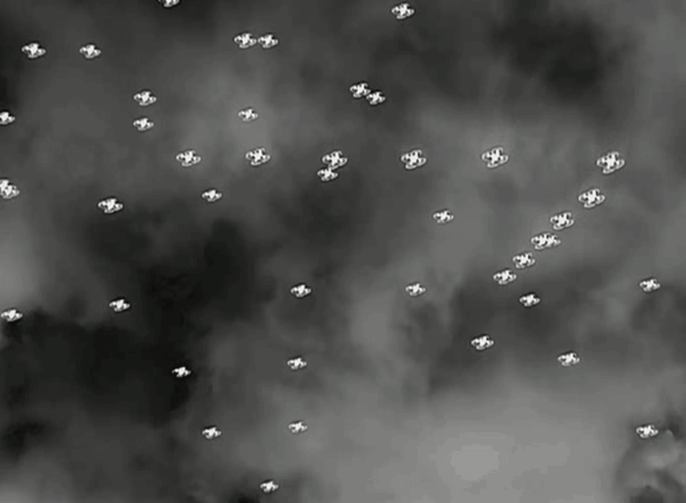
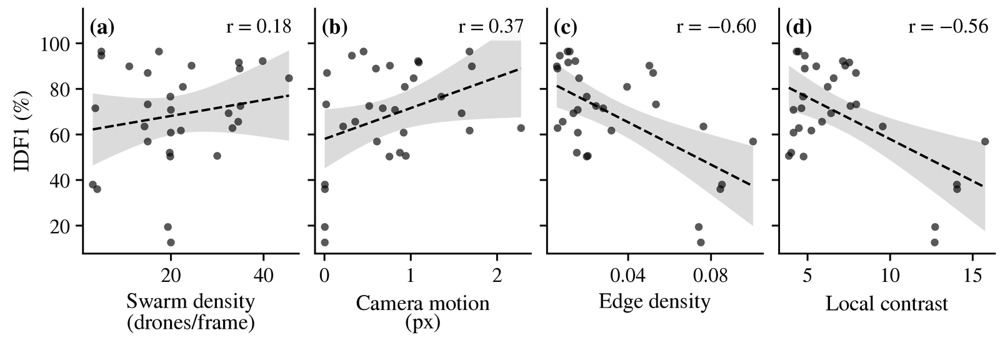
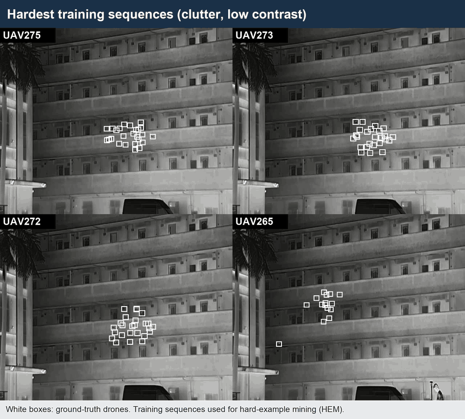
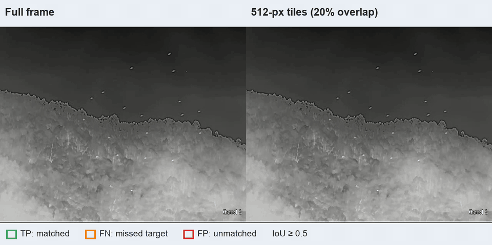
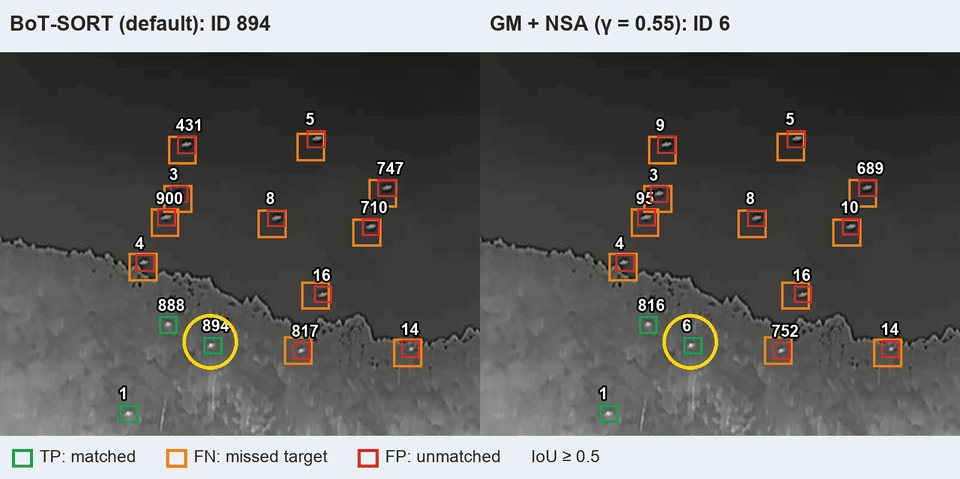
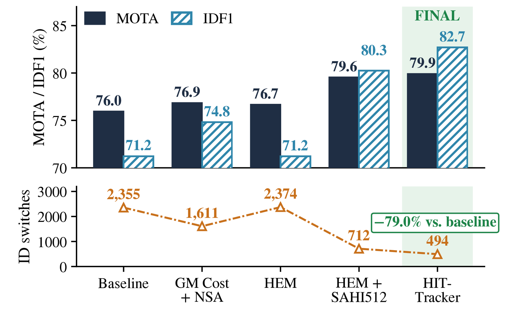
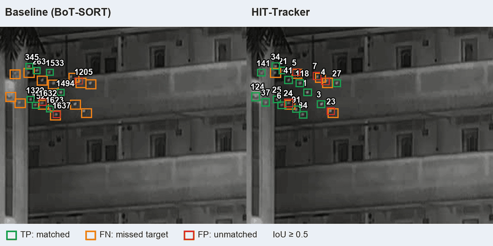
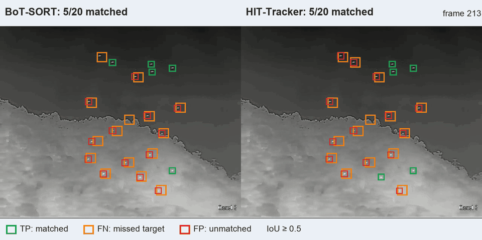
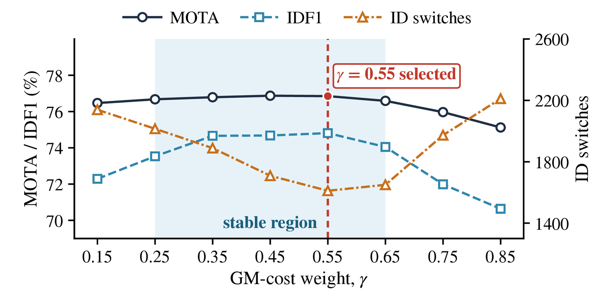

# From Baseline to HIT-Tracker: An Experimentally Optimized Pipeline for Infrared Multi-UAV Tracking

**Ighor de Souza Ribeiro** (CIAA), **Rigel Procópio Fernandes** (DSAM), **Gabriel de Sapienza Luna** (CIAA / UFRJ)

LAFusion 2026 — Fourth Latin American Workshop on Information Fusion

**[Slides (PDF)](slides/LAFusion2026_slides.pdf)**

---

## Slide 2 · From One UAV to a Swarm

One visible UAV is easy to follow; in infrared swarms the targets are small, textureless and look alike.

## Slide 6 · Root Cause

Structured clutter (edge density) correlates with IDF1 at r = −0.600; swarm density and camera motion do not explain identity loss.

## Slide 8 · H: Hard-Example Mining

The hardest training sequences (clutter, low contrast) are used to fine-tune the detector.

## Slide 9 · T: Tiled Inference (SAHI)

Overlapping 512-px tiles help the detector find small targets (green: matched, orange: missed).

## Slide 12 · I in Action

BoT-SORT switches the ID of the circled drone (894 → 1051); GM + NSA (γ = 0.55) keeps it (ID 6).

## Slide 14 · HIT-Tracker Results

MOTA 76.0 → 79.9, IDF1 71.2 → 82.7, identity switches 2,355 → 494 (−79.0%).

## Slide 15 · Seeing the Difference

Same facade sequence: the baseline keeps changing identities, HIT-Tracker keeps them.

## Backup · UAV240, Frame 309

Matched targets per frame; at frame 309, BoT-SORT matches 5 of 20 and HIT-Tracker matches 20 of 20.

## Backup · γ Sweep

MOTA stays within 0.3 p.p. of its maximum for γ ∈ [0.25, 0.65]; identity switches are lowest at γ = 0.55.

---

## Code and paper

- Code and experimental materials: [github.com/IghorRibeiro/DroneTrackingMOT](https://github.com/IghorRibeiro/DroneTrackingMOT)
- Citation: I. S. Ribeiro, R. P. Fernandes and G. S. Luna, "From Baseline to HIT-Tracker: An Experimentally Optimized Pipeline for Infrared Multi-UAV Tracking," Fourth Latin American Workshop on Information Fusion (LAFusion 2026), Springer CCIS, to appear.

## Credits

- 4th Anti-UAV Challenge, Track 3 (China Telecom, 2025), DOI [10.5281/zenodo.15103888](https://doi.org/10.5281/zenodo.15103888)
- DUT Anti-UAV (Zhao et al., 2022)

Images derived from these datasets follow the original dataset terms.
